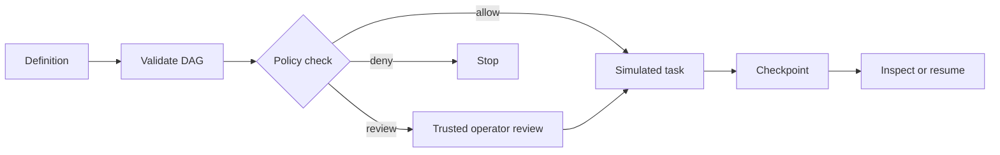

# workflowOps

**Build agents that finish reliably.**

Local-first governed workflow execution with deterministic DAGs, checkpointing and simulated effects.

  [](https://github.com/ops-universe/workflowOps/actions/workflows/ci.yml)

> Development source repository. Public release is deferred. See [implementation status](docs/status/IMPLEMENTATION-STATUS.md) for scoped evidence and limitations.

## Why workflowOps?

Make dependencies, execution state, retry behavior and authorization explicit so workflows can be inspected and resumed conservatively.

## Features

- Versioned workflow contracts, deterministic DAG validation and task execution.
- Local checkpoint persistence and conservative resume.
- Bounded retries, cooperative timeouts/cancellation and recovery.
- Permissioned registry, scoped approvals, dry runs and offline mock AI attempt quotas.
- Synthetic CLI, read-only loopback dashboard and durable timeline.

## Architecture



[Architecture](docs/architecture/overview.md) · [Reliability](docs/architecture/reliability.md) · [Offline AI](docs/architecture/ai.md)

## Quickstart

Requires Node.js 22+ and npm. Work from the repository root; the package is private and not presented as an npm release.

```sh
git clone https://github.com/ops-universe/workflowOps.git
cd workflowOps
npm ci
npm test
npm run demo
```

## CLI and examples

Use synthetic fixtures only.

```sh
node src/bin.mjs validate supplier
node src/bin.mjs dag supplier
node src/bin.mjs dry-run supplier ./local-state
node src/bin.mjs run supplier ./local-state
# Replace EXECUTION_ID with the returned execution ID
node src/bin.mjs inspect supplier ./local-state EXECUTION_ID
node src/bin.mjs approve supplier ./local-state EXECUTION_ID operator
node src/bin.mjs resume supplier ./local-state EXECUTION_ID
```

## Configuration

Use a trusted local checkpoint directory, operator and scenario. Built-in scenarios: supplier, documents, support and recovery. See [workflow contract](docs/architecture/workflow-contract.md), [checkpoints](docs/architecture/checkpoints.md) and [governance](docs/architecture/governance.md). The approval/resume commands apply only when the execution has an appropriate pending approval.

## Scope and limitations

All demo effects are simulated. Trusted local host/operator/root required; no authenticated storage, sandbox or tenant isolation. Cooperative cancellation cannot hard-kill handlers. No exactly-once, power-loss durability, live providers or monetary/token/global AI budget guarantee.

Read the [threat model](docs/security/threat-model.md) before integrating with real data or systems.

## Roadmap

See [ROADMAP.md](ROADMAP.md) and [implementation status](docs/status/IMPLEMENTATION-STATUS.md). Developer Preview launch and public release remain deferred.

## Contributing and support

Read [CONTRIBUTING.md](CONTRIBUTING.md), [Code of Conduct](CODE_OF_CONDUCT.md), and [SECURITY.md](SECURITY.md). Open a focused [issue](https://github.com/ops-universe/workflowOps/issues) with a minimal synthetic reproduction or documentation proposal. Run `npm ci` and `npm test` before opening a focused PR. Report security concerns using the security policy rather than public issues.

## Related projects

[evalOps](https://github.com/ops-universe/evalOps) · [guardOps](https://github.com/ops-universe/guardOps) · [ragOps](https://github.com/ops-universe/ragOps) · [traceOps](https://github.com/ops-universe/traceOps) · [mcpOps](https://github.com/ops-universe/mcpOps) · [dataOps](https://github.com/ops-universe/dataOps) · [Ops Universe](https://github.com/ops-universe)

## License

[MIT](LICENSE)
